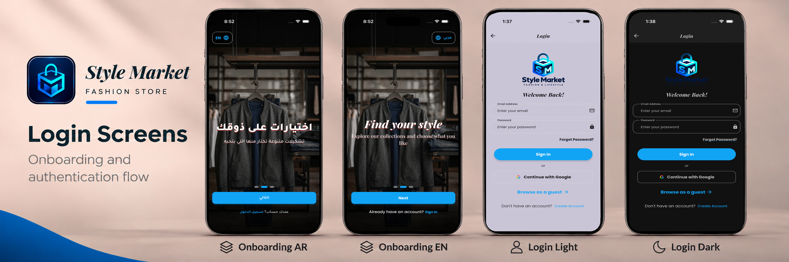
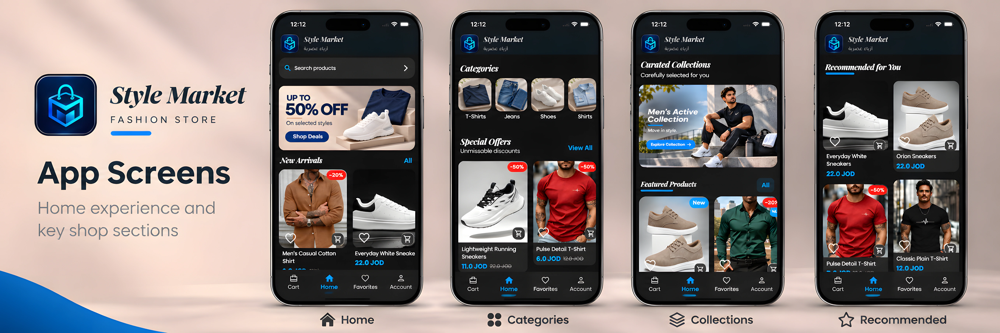
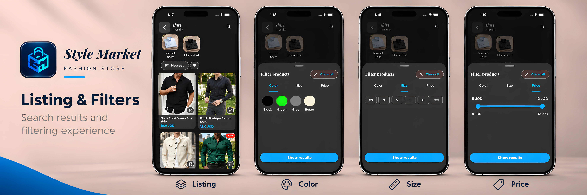
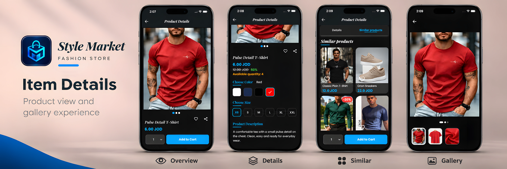
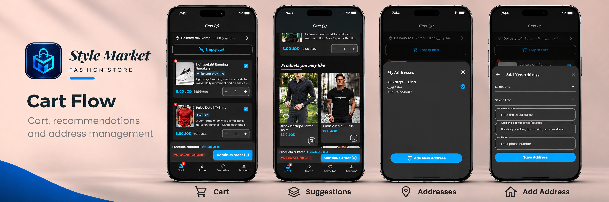
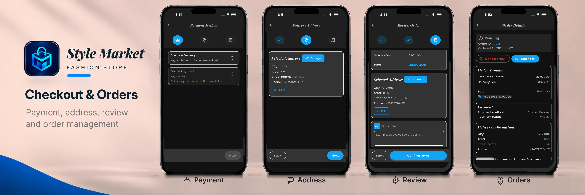
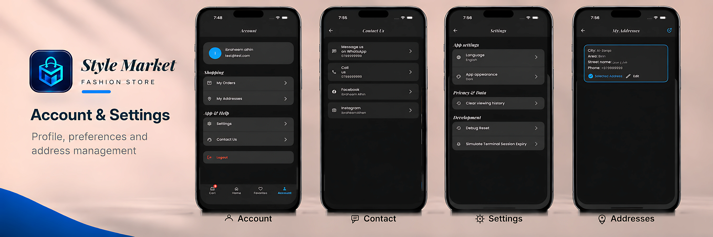
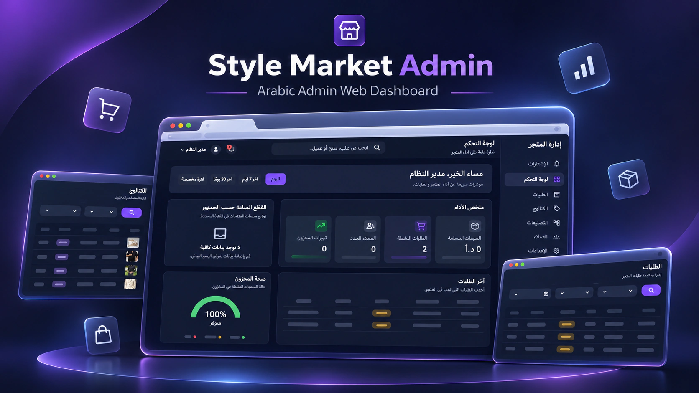

# Style Market

### Flutter shopping app + Flutter Web admin dashboard

A complete fashion shopping experience built with Flutter, from browsing products and managing variants to checkout, orders, inventory, and store administration.

**Mobile App** · **Flutter Web Admin** · **REST API Integration**

## 📲 Try the Demo

**[⬇️ Download Android APK — v1.0.1](https://github.com/ibraheem1996/style-market-showcase/releases/download/v1.0.1/style-market-demo-1.0.1.apk)** · **[🌐 Open Live Admin Web](https://style-market-demo.duckdns.org/)**

The Android APK is distributed through GitHub Releases. On Android, installation from your browser or file manager may need to be allowed.

---

## ✨ What is Style Market?

Style Market is an e-commerce project built around two Flutter applications:

| 📱 Customer App                       | 🖥️ Admin Dashboard                  |
| ------------------------------------- | ----------------------------------- |
| Browse and search products            | Monitor store activity              |
| View colors, sizes, prices, and stock | Manage products and variants        |
| Cart and favorites                    | Manage product images and inventory |
| Addresses and checkout                | Review and manage orders            |
| Order history and details             | Manage catalog content              |
| Arabic and English support            | Responsive Flutter Web interface    |

The two applications communicate with the same REST API while keeping their UI, state, routing, and client logic separate.

---

## 📱 Customer App

The mobile app focuses on a smooth shopping flow from discovery to order tracking.

### Main experience

- 🔎 Product search, listing, sorting, and filters
- 👕 Product details with color and size variants
- ❤️ Favorites and shared favorite state
- 🛒 Cart with quantity, selection, and pricing logic
- 📍 Address management and phone verification
- 💳 Multi-step checkout
- 📦 Orders and order details
- 👀 Recently viewed products
- 🌍 Arabic and English localization
- 📐 Responsive and reusable UI components
- 🔐 Session and token handling
- 🔔 Notification integration

### Mobile Application Walkthrough

The visual showcase reflects the logical customer journey through the mobile app—from discovery to post-order management:

#### 1. Onboarding & Authentication

Bilingual onboarding (Arabic & English) with guest access and authentication in light and dark modes.

#### 2. Storefront & Product Discovery

Dynamic promotional banners, categorized shopping shortcuts, curated collections,
curated featured products,
and personalized recommendations.

#### 3. Product Listing & Smart Filtering

Catalog search and browsing with instant bottom-sheet filters for color swatches, size availability, and price ranges.

#### 4. Product Details & Variant Selection

Interactive product showcase featuring multi-angle media galleries, color/size matrices, stock checks, and similar items.

#### 5. Cart & Delivery Addresses

Synchronized shopping cart with quantity controls, cross-sell suggestions, and saved delivery address selection.

#### 6. Multi-Step Checkout & Orders

Frictionless checkout pipeline with payment method selection, address verification, order review, and real-time status tracking.

#### 7. Account, Preferences & Localization

User profile management, instant Arabic/English locale switching, theme preference toggles, and direct support channels.

---

## 🖥️ Admin Dashboard

The Admin application is built with Flutter Web and focuses on store operations rather than a simple CRUD panel.

### Main experience

- 📊 Dashboard metrics and charts
- 📦 Order management and status actions
- 📝 Internal order notes
- 🛍️ Product and variant management
- 🖼️ Product media upload, ordering, and primary-image control
- 📉 Product lifecycle and deletion-impact checks
- 🌳 Category tree management
- 🧩 Collection item ordering and validation
- 🎯 Audience, banner, color, and size management
- 🧭 Session-aware routing
- 📐 Responsive sidebar and compact layouts

### Admin Web Walkthrough & Preview

The administrative panel provides a centralized, RTL-native desktop workspace tailored for daily retail operations and catalog management.

#### Dashboard & Operations Overview
High-level operational overview featuring real-time revenue and order metrics, customer acquisition stats, inventory health monitoring, and modular catalog & order panels.

#### Interactive Store Operations Walkthrough
Demonstration of order lifecycle management, customer data management, payment tracking, and daily store administration workflows.

https://github.com/user-attachments/assets/1959bec5-ffcd-4a04-bf8d-1e9fb0747f2b

> 📹 **Video Walkthrough (83s)**: [Watch or Download `admin-walkthrough.mp4` (Full HD)](assets/screenshots/admin/admin-walkthrough.mp4) — covers order detail inspection (`#215`), status transitions, customer data verification, and sidebar navigation.

---

## 🚀 Engineering Highlights

The project includes more than screens and API calls. Some of the main engineering work includes:

### 🔄 Reliable client state

- Shared Cart and Favorites state across multiple screens
- Optimistic updates with rollback and reconciliation
- Protection against stale async responses
- Session-aware state cleanup
- Clear separation between screen state and shared application state

### 🌐 Networking & sessions

- Dio and Retrofit API integration
- Centralized request and authentication interceptors
- Token refresh and request retry handling
- Typed API failures instead of raw network errors
- Separate customer and admin session flows

### 📐 Responsive UI

- Centralized breakpoints and layout values
- Adaptive product grids and content widths
- Responsive Flutter Web shell
- Sidebar / compact navigation behavior
- Reusable typography, spacing, media, and theme rules

### 🧠 Business logic outside widgets

Examples include:

- Product variant selection rules
- Duplicate variant detection
- Cart pricing and local mutation logic
- Product deletion-impact checks
- Category tree operations
- Collection item validation and ordering
- Order filtering, pagination, and actions

---

## 🧭 Architecture

The project uses a **feature-first Flutter architecture**.

The Mobile app mainly uses **GetX**, while the Admin Dashboard uses **Cubit / Flutter Bloc** and **GoRouter**.

The architecture is kept practical: simple features stay simple, while complex flows get clearer state, domain, and data boundaries.

### 👉 [Read the Architecture Guide](docs/architecture.md)

The architecture guide explains the original project structure, state management, networking, routing, dependency injection, and data flow with simple diagrams.

---

## 🧰 Tech Stack

| Area                  | Technology                                                     |
| --------------------- | -------------------------------------------------------------- |
| Mobile                | Flutter, Dart, GetX                                            |
| Admin Web             | Flutter Web, Flutter Bloc / Cubit                              |
| Routing               | GetX routing, GoRouter                                         |
| Networking            | Dio, Retrofit                                                  |
| Dependency Injection  | GetIt, Injectable, GetX bindings                               |
| Models & State        | Freezed, JSON serialization                                    |
| Backend Communication | REST API                                                       |
| Firebase              | Authentication, Messaging, Crashlytics, Analytics, Performance |
| Local Storage         | Shared Preferences, secure/session storage                     |
| Testing               | Flutter Test, mocks/fakes, Cubit tests                         |

---

## 🧪 Testing

Testing focuses on behavior that is easy to break and important to the user experience, such as:

- Async request ordering
- Cart and favorites mutations
- Authentication and session behavior
- Responsive layout rules
- Product variant logic
- Checkout state
- Order actions
- Dashboard mapping
- Product media operations

---

## 🔍 Explore the Code

This repository contains selected Flutter source from the real project.

The code samples focus on useful engineering examples rather than publishing every feature or every layer.

- 📱 [Mobile code samples](code-samples/mobile/)
- 🖥️ [Admin code samples](code-samples/admin/)
- 🧭 [Architecture](docs/architecture.md)

---

## 🎬 Demo & Media

- 📱 **Customer Mobile App**: 7 visual showcases detailing onboarding through checkout (see [Mobile Walkthrough](#mobile-application-walkthrough))
- 🖥️ **Admin Web Dashboard**: Overview render and 83-second live operations walkthrough (see [Admin Preview](#admin-web-walkthrough--preview))
- 🔗 **Android APK v1.0.1**: [Download APK](https://github.com/ibraheem1996/style-market-showcase/releases/download/v1.0.1/style-market-demo-1.0.1.apk)
- 🌐 **Live Admin Web**: [Open web demo](https://style-market-demo.duckdns.org/)

---

## 🔒 Source Availability

The complete Style Market source is maintained privately.

---

### Built with Flutter 💙

**Style Market — Mobile shopping + Web administration in one project**

