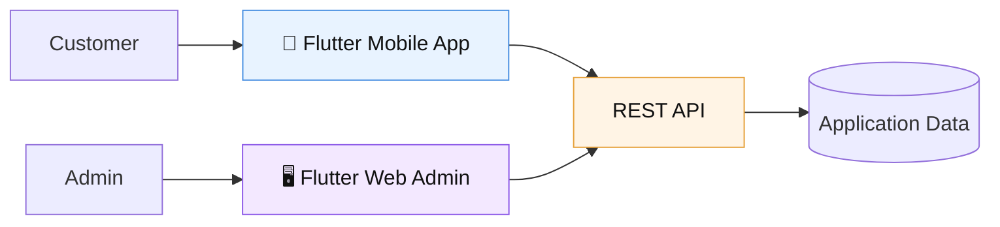
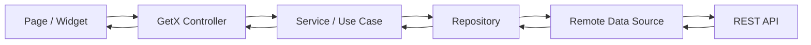
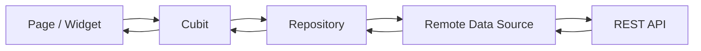
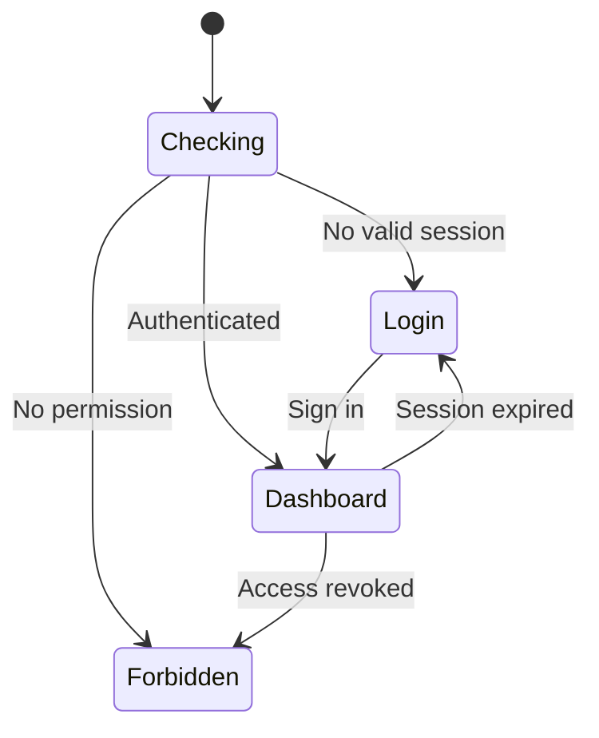

# 🧭 Style Market Architecture

> A simple view of how the original Style Market applications are organized and how data moves through them.

Style Market has two Flutter clients:

- 📱 **Customer App** — Flutter mobile application
- 🖥️ **Admin Dashboard** — Flutter Web application

Both clients communicate with the same external **REST API**.

---

## 🌐 High-level view



The backend is treated as an external system from the Flutter side.  
Each Flutter app owns its own presentation, state, navigation, and client-side logic.

---

# 📱 Mobile App

The mobile app uses a **feature-first structure**.

Each feature keeps its own UI, state, domain logic, and data code close together.

```text
feature/
├── presentation/
│   ├── pages
│   ├── controllers
│   ├── state / events
│   └── widgets
│
├── domain/
│   ├── entities
│   ├── repository contracts
│   └── use cases when needed
│
└── data/
    ├── data sources
    ├── models / mappers
    └── repository implementations
```

### 🧠 State management

The mobile app mainly uses **GetX**.

- Controllers manage screen or feature state.
- Services and stores keep state that is shared across screens.
- Bindings connect screens with their dependencies.
- Navigation is handled through GetX routing.

Shared state is used for things such as:

- Cart
- Favorites
- Session
- Audience selection
- Recently viewed items

This keeps shared behavior in one place instead of repeating it in every screen.

---

### 🔄 Mobile data flow



Not every feature needs every layer.

Simple flows stay simple.  
More complex flows use separate services, use cases, stores, or domain logic when that separation is useful.

---

### 🌍 Networking and errors

The mobile app uses:

- **Dio**
- **Retrofit**
- Centralized interceptors
- Typed failures and results

Authentication is handled at the network layer, including token use and session refresh.

Repositories convert raw network responses into domain-friendly results before they reach the UI.

---

### 🎨 UI system

Common UI behavior is centralized through:

- Theme and typography
- Responsive layout helpers
- Shared media components
- Reusable buttons and product components
- Common overlays
- Localization

The goal is to keep screens visually consistent without repeating layout rules everywhere.

---

# 🖥️ Admin Web

The Admin Dashboard is also organized by feature, but its state management and navigation are different from the mobile app.

```text
feature/
├── presentation/
│   ├── pages
│   ├── cubit
│   ├── state / effects
│   └── widgets
│
├── domain/
│   ├── entities
│   └── repository contracts
│
└── data/
    ├── data sources
    ├── DTOs / mappers
    └── repository implementations
```

### 🧠 State management

The Admin app uses **Flutter Bloc / Cubit**.

Cubits are responsible for things such as:

- Loading data
- Filtering and pagination
- Form state
- Mutations
- Success and error effects
- Refreshing data after an action

This keeps business state outside the widgets and makes complex admin flows easier to follow.

---

### 🔄 Admin data flow



Some flows also use a use case when it gives the operation a clearer domain boundary.

---

### 🧭 Routing

The Admin app uses **GoRouter**.

Routing is connected to the admin session state.



The authenticated area is built around a shared Admin shell with:

- Sidebar navigation
- Top bar
- Responsive layout
- Route-aware content

---

### 🧩 Dependency injection

The Admin app uses:

- **GetIt**
- **Injectable**

Dependencies such as repositories, Cubits, networking clients, and session services are registered centrally and injected where needed.

---

### 🖥️ Responsive web layout

The Admin UI is designed for different screen widths.

The shared responsive layer controls things such as:

- Breakpoints
- Sidebar behavior
- Page spacing
- Content widths
- Layout values

This allows the same Admin app to adapt from compact screens to wide desktop layouts.

---

# 🔐 Shared architecture concerns

Both applications handle the same general concerns, but each app has its own implementation.

| Concern | Mobile | Admin Web |
|---|---|---|
| State | GetX | Cubit / Bloc |
| Navigation | GetX routing | GoRouter |
| Networking | Dio + Retrofit | Dio + Retrofit |
| Dependency injection | GetX / service registration | GetIt + Injectable |
| Error handling | Typed failures / results | AppFailure / AppResult |
| Responsive UI | Mobile + adaptive layouts | Responsive web shell |
| Authentication | Customer session | Admin session |

---

# 🧱 Design principle

The project does not force every feature into the exact same shape.

The main rule is simple:

> **Separate UI, state, business logic, and data access when the feature is complex enough to benefit from it.**

Small features stay small.  
Complex features get clearer boundaries.

That keeps the code easier to read, test, and change without adding layers only for the sake of architecture.

---

## ✨ In one sentence

**Style Market uses feature-first Flutter architecture, with GetX on Mobile and Cubit on Admin, while keeping networking, session handling, responsive UI, and shared application concerns centralized.**
